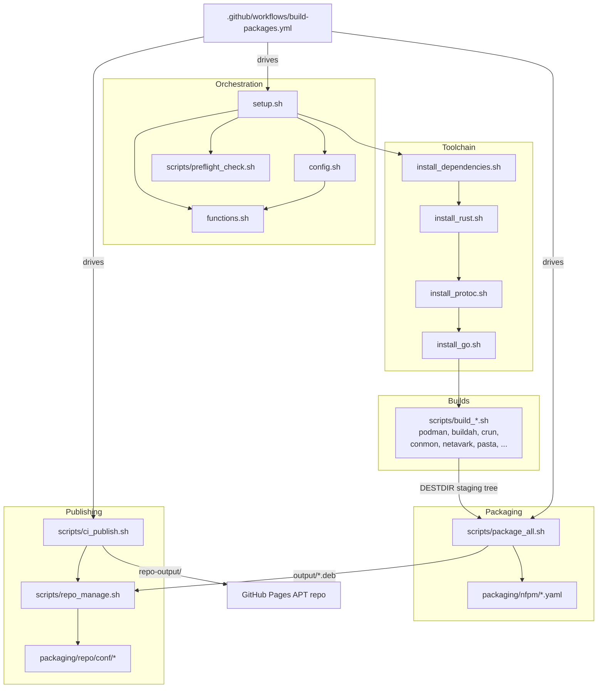

# Architecture

This project builds the Podman container stack from upstream source for Debian 12 (bookworm) and Debian 13 (trixie) on amd64, packages it as `.deb` files, and publishes a signed APT repository on GitHub Pages.

It is a shell pipeline, not an application. `setup.sh` sources a shared configuration (`config.sh`) and function library (`functions.sh`), then runs one build script per component. Each script compiles its upstream project into a shared staging tree (`DESTDIR`). `scripts/package_all.sh` turns that tree into Debian packages with [nFPM](https://nfpm.goreleaser.com/). `scripts/ci_publish.sh` and `scripts/repo_manage.sh` assemble the packages into a [reprepro](https://wiki.debian.org/reprepro) repository. A GitHub Actions workflow runs the whole pipeline for three release tracks: stable, v5 and nightly.

## Components



## Supported distros

The supported releases are listed once, in the distro table near the top of `config.sh`:

| Variable | Value | Use |
|----------|-------|-----|
| `VALID_TRACKS` | `stable v5 nightly` | Release tracks |
| `VALID_DISTROS` | `bookworm trixie` | Distro labels (release codenames) |
| `VALID_ARCHES` | `amd64` | Architectures built and published |
| `DISTRO_VERSION_IDS` | `bookworm=12`, `trixie=13` | `VERSION_ID` from `/etc/os-release`, used in the version suffix |
| `DISTRO_IMAGES` | `docker.io/library/debian:<label>` | Container image for CI builds and smoke tests |
| `ALL_SUITES` | derived | Every `{track}-{label}` pair |

Everything else derives from this table: suite routing, the CI build matrix (`scripts/ci_matrix.sh`), the publish and smoke loops in the workflow, the republish guard, the landing page, and the tests. Scripts that must not run the rest of `config.sh` (it detects the host distro and makes network calls) read only this block:

```bash
eval "$(sed -n '/^VALID_TRACKS=/,/^unset _distro _track$/p' config.sh)"
```

Adding a release means adding it to the table and to `packaging/repo/conf/distributions`, then adding its library baseline to `scripts/verify_depends.sh`.

## Distro detection and versions

`detect_distro_version_id` in `functions.sh` decides which release a build targets:

1. If `DISTRO` is set, it is used. It may be a codename (`bookworm`) or a `VERSION_ID` (`12`). `/etc/os-release` is not read.
2. Otherwise `${OS_RELEASE_FILE:-/etc/os-release}` is read. `ID` must be `debian` and `VERSION_ID` must be set. Debian testing and unstable have no `VERSION_ID` and are rejected.
3. Anything else fails with an error naming the supported releases.

`config.sh` exports the result as `DISTRO_VERSION_ID` and the matching codename as `DISTRO_LABEL`, and stops loading if detection fails. `detect_architecture` accepts only `x86_64` (amd64).

Every package version ends in `~deb{VERSION_ID}.podman{N}`, for example `5.8.2~deb12.podman1`. `N` is `PACKAGE_REVISION` from `scripts/package_revision.sh`. The suffix gives these dpkg orderings, which `scripts/verify_versions.sh` checks:

- A bookworm build sorts below the trixie build of the same version, so a dist-upgrade from 12 to 13 moves to the trixie package.
- A newer upstream version wins regardless of distro suffix.
- A revision bump (`podman1` to `podman2`) upgrades existing installs.
- Nightly builds sort below the tagged release of the same base version.

Nightly versions use a double tilde: `{base}~~git{YYYYMMDD}.{sha}~deb12.podman1`. A single `~git` would sort above `~deb`, because dpkg compares the letters and `g` is greater than `d`. A tagged release would then look older than the nightly build before it. `~~` sorts below any `~d...`.

The suffix also sorts below Debian's own package of the same upstream version (for example `5.4.2+ds1-2`). This does not affect apt's choice, because these packages have different names (`podman-podman`, `podman-crun`, ...) and replace Debian's through `Conflicts`, `Replaces` and `Provides`.

## Data flow

1. Track resolution. For stable (Podman 6.x) and v5 (Podman 5.x), `scripts/resolve_versions.sh` reads a policy file (`versions-stable.env` or `versions-v5.env`) and prints concrete `*_TAG` values. For each component an exact `*_TAG` wins; otherwise a `*_SERIES` prefix cap selects the highest matching tag (`PODMAN_SERIES=6` picks the highest `6.x`); otherwise the latest upstream release is used. Buildah is derived from Podman's `go.mod` at the resolved Podman tag. A non-frozen tag is only adopted once its commit is `STABLE_SOAK_DAYS` old (default 7). For nightly, `NIGHTLY_BUILD=true` and `SHALLOW_CLONE=false` build from upstream HEAD.

2. Preflight and configuration. `setup.sh` sources `config.sh`, which detects the architecture and distro and reads the Go version from Podman's `go.mod` and the Rust version from Netavark's `Cargo.toml`. `scripts/preflight_check.sh` checks cgroups v2, subuid/subgid, FUSE, the kernel version and noexec mounts.

3. Toolchain. `install_dependencies.sh` installs the build packages for the target release (`systemd` provides `systemd.pc` on bookworm, `systemd-dev` on trixie). `install_rust.sh`, `install_protoc.sh` and `install_go.sh` install the toolchains from upstream.

4. Builds. Each `scripts/build_*.sh` clones its upstream repository into `build/<component>/` with `git_clone_update`, checks out the tag with `git_checkout`, compiles, and installs into `DESTDIR`.

5. Packaging. `scripts/package_all.sh` derives each version (from the tag, or from source files for nightly), fills in `packaging/nfpm/<component>.yaml` with `envsubst`, and runs `nfpm pkg` to write a `.deb` into `output/`. System-library `Depends` come from `detect_runtime_depends` in `functions.sh`, which maps each shipped binary's direct `DT_NEEDED` sonames to their owning packages with `dpkg-query -S`. The `podman-suite` meta-package depends on the whole stack.

6. Publishing. `scripts/ci_publish.sh` builds one distro's suite from fresh `.deb` files and carries every other suite over from the live repository. `scripts/repo_byhash.sh` adds Acquire-By-Hash and re-signs. `scripts/index_html.sh` writes the landing page.

7. Use. Users add one `{track}-{label}` suite and install `podman-suite`.

## CI and publishing

`.github/workflows/build-packages.yml` runs on three daily schedules, `30 4` (nightly), `30 5` (stable) and `30 6` (v5) UTC, and on `workflow_dispatch` with a `build_track` choice and a `force_rebuild` flag.

Runs queue instead of replacing each other. Each track has its own workflow concurrency group (`build-packages-<track>`) with `queue: max`, so a second run of a track waits for the first, and no pending run is cancelled. GitHub's default for a group keeps only one pending run and cancels the rest, which is how a scheduled run could silently disappear. Different tracks build in parallel. The `publish` job has its own group, `pages-deploy`, also with `queue: max`, so only one run at a time assembles and deploys the repository.

The workflow grants only `contents: read`. The `publish` job adds `pages: write` and `id-token: write` for the deploy and `actions: read` to list this run's jobs. Every checkout sets `persist-credentials: false`.

- `resolve-track` maps the firing cron or dispatch input to a track and runs `scripts/ci_matrix.sh` to produce the build matrix as JSON, one cell per entry in `VALID_DISTROS`. For stable and v5 it also runs `scripts/resolve_versions.sh`, once per run, and passes the output (`resolved_env`) to the guard and every build cell. Each consumer checks it with `validate_resolved_env` before use. A hold (exit code 3: upstream is reachable, but no release has passed its soak period yet) sets `hold=true`: nothing is built or published and the run succeeds, even with `force_rebuild`. Any other resolver failure fails the run.
- `check-changes` runs only on the nightly cron. It restores the nightly checkpoint (restore only, it never saves) and compares each component's upstream HEAD with the commit last deployed for each distro. It skips the build only when every distro is current. A missing checkpoint, or an upstream repository that cannot be read, also leads to a build.
- `check-republish` runs for stable and v5 unless the resolver held. `scripts/check_republish_needed.sh` takes the resolved environment and compares it with the `Packages` index of every `{track}-{label}` suite in the live repository. It skips the build only when every component, pasta and the `podman-suite` meta-package included, matches on every distro. Any failed download leads to a build; an invalid resolved environment fails the job.
- `build` is a single matrix job with `fail-fast: false`, one job per distro named `build-<label>`. Each cell runs in its distro's Debian container on a GitHub-hosted amd64 runner. The steps bootstrap `sudo`, `git`, `curl` and `ca-certificates`, check version ordering with `verify_versions.sh`, turn the track into `KEY=VALUE` pairs for `setup.sh`, restore the Go and compiler caches, run `setup.sh` with `DISTRO=<label>` and `SKIP_FUSE_CHECK=true` (the job container cannot open `/dev/fuse`), check that the compiler caches were used, package with the same `DISTRO`, and check the detected library dependencies with `verify_depends.sh`. On nightly, each cell records the upstream commits it built (`nightly-revs-<label>`). The cache keys and artifact names (`debs-<label>`) carry the distro.
- `publish` runs on `main` when at least one build cell succeeded. It runs the doc, landing-page and repo-assembly tests, reads each build cell's conclusion from the GitHub API, and downloads each artifact into its own directory (`artifacts/debs-<label>/`). It publishes exactly the distros whose cell succeeded; if a successful cell's artifact is missing, the job fails instead of publishing less. It calls `ci_publish.sh` once per selected distro in `VALID_DISTROS` order into one `repo-output/`, runs `verify_repo_integrity.sh --keyring` over the result, runs `smoke_repo_install.sh` for each selected distro, and deploys to Pages in one step. It then waits until each published suite's live `InRelease` matches the deployed one. On nightly, only after that, it merges the selected distros' revisions into the checkpoint and saves it.

### Nightly checkpoint

The checkpoint is a cache entry (`nightly-rev-v2-*`) holding one line per distro and component: `<distro> <component> <commit>`. Build cells record what they compiled; the publish job folds in only the distros it deployed, and only after the deploy reached the live site. If the trixie cell fails, bookworm's commits are checkpointed and trixie keeps its old entries, so the next nightly cron rebuilds trixie. The helpers live in `scripts/ci_helpers.sh` (`nightly_record_revisions`, `nightly_detect_changes`, `nightly_merge_revisions`).

### Compiler caches

Go module and build caches are kept per distro and track, as before. Rust (sccache) and C (ccache) output is cached too, under one key per distro, architecture, track, Rust version and sccache version: `cc-v1-<label>-amd64-<track>-rust<version>-sccache<version>-<run id>`, restored by prefix from the latest matching run. The key only picks a starting point. sccache hashes the `rustc` binary and ccache hashes the compiler (`compilercheck=content`), so a toolchain change behind the same key misses the cache instead of reusing a wrong object. CI caps sccache at 1 GB and ccache at 500 MB, and sets `CACHE_STRICT=true`, which fails the build when an enabled wrapper is missing. After the build, `compiler_cache_report` prints both tools' statistics and fails the cell if an enabled cache saw no compile requests. The caches hold compiler output only, never signing keys or repository state.

To reproduce the publish locally:

```bash
# Assemble one (track, distro) into an accumulating output directory
./scripts/ci_publish.sh <stable|v5|nightly> <bookworm|trixie> <deb-dir> <repo-url> repo-output
# Build a single suite without mirroring the others
./scripts/repo_manage.sh <track> <distro> <deb-dir> [output-dir]
```

Both scripts use their distro argument as the `DISTRO` override, so they do not read the publishing host's `/etc/os-release`.

### Suite assembly

`resolve_publish_targets <track> <distro>` in `config.sh` returns the single suite a build publishes to, `<track>-<distro>`. There are no bare track suites. `ci_publish.sh` treats every other suite in `ALL_SUITES` as an untouched suite:

- A suite an earlier pass already wrote into the output directory is kept in place. Without this, the trixie pass would re-mirror the live, older `stable-bookworm` over the one the bookworm pass just built.
- A suite with a live tree is mirrored verbatim: the signed `Release`, `InRelease`, `Release.gpg`, the indexes it lists (checked against the signed hashes) and the pool files they reference. Its signature and `Date` stay byte-identical, which keeps the Acquire-By-Hash window on GitHub Pages' content delivery network closed.
- A suite with no live tree (first publish) stays empty.

The target suite is then built from the fresh `.deb` files, and Acquire-By-Hash plus re-signing is applied to every suite that was not served verbatim. A verbatim suite whose signatures do not verify against the published key (after a signing-key rotation) has its unchanged `Release` re-signed with the current key; its indexes and `by-hash/` stay byte-identical.

Every download from the live repository goes through `fetch_url` (`scripts/ci_helpers.sh`), which retries network and TLS errors, cut-off transfers and HTTP 408, 429 and 5xx, and tells "absent" (HTTP 404 or 410) apart from "failed". Only "absent" means a suite or file is not published. A download that still fails after the retries stops the publish, so a brief outage of the content delivery network in front of GitHub Pages can never make a suite look empty or drop a package from it. Each request carries a throwaway query string and a `no-cache` header, so a cache in front of GitHub Pages does not answer with a copy from before the last deploy.

A regenerated suite (the target, or a healed one) keeps the previous generation of its indexes under `by-hash/`: `ci_publish.sh` copies the live suite's current indexes and `Release` in next to the new ones. A client that read the old `Release` just before the deploy can still fetch the indexes it names. Only that one previous generation is kept, so `by-hash/` does not grow over time.

### Pool immutability

reprepro keeps one `pool/` for all suites, keyed by source, version and architecture. A component version shipped by two tracks (for example the same skopeo in stable and v5) has a single pool file, and every suite's signed index checksums that file. Two mechanisms keep the pool and the indexes in agreement, and one checks it:

- Prevent: before building the target suite, `ci_publish.sh` adopts any already-published pool file with the same name instead of overwriting it with a fresh, non-reproducible rebuild. It checks two places: the pool assembled so far (the other suites), and the live index of the target suite itself. A package whose name, version and architecture the live target index already lists (an unchanged component in a new build) is downloaded and its published bytes are used; the fresh rebuild is dropped.
- Heal: a suite is only served verbatim if every pool file it references still matches its signed `Size` and `SHA256`. Otherwise it is re-exported from the real pool bytes and re-signed. This covers only complete downloads whose bytes disagree with the index. A pool file the index names but the live site does not have (HTTP 404), or a download that fails, stops the publish instead: regenerating the suite without the file would silently drop a package.
- Verify: `scripts/verify_repo_integrity.sh` runs at the end of every `ci_publish.sh` pass and again before the Pages upload. It fails the publish if any `Release`, index or pool checksum disagrees, if a `Release` lacks `Suite`, `Codename`, its `SHA256` section or a `Packages` entry for a declared architecture, or if a `Packages` stanza lacks `Size` or `SHA256`. With `--keyring` it also checks both signatures of every suite with `gpgv` against the published key, and that `InRelease` signs exactly the text of `Release`.

### Signing

`GPG_PRIVATE_KEY` is imported with ultimate ownertrust and reprepro signs each suite. `repo_byhash.sh` re-signs after adding `Acquire-By-Hash` to `Release`, since editing `Release` invalidates reprepro's signature. It checks every step and returns non-zero if either signature cannot be written or does not verify afterwards; `ci_publish.sh` stops on that. The public key is published as `podman-debian.gpg`, copied from `packaging/repo/pubkey.gpg` when that file exists and exported from the signing keyring otherwise. The integrity gate verifies every suite against that file, and the smoke test points apt's `Signed-By` at it, so a suite signed with any other key fails before the deploy.

## Key functions

- `detect_architecture`, `detect_distro_version_id`, `distro_label_for_version_id` (`functions.sh`): host and target detection, described above.
- `is_valid_suite`, `resolve_publish_targets` (`config.sh`): suite validation and routing.
- `get_required_go_version`, `get_required_rust_version` (`functions.sh`): read toolchain versions from Podman's `go.mod` and Netavark's `Cargo.toml`.
- `git_clone_update`, `git_checkout` (`functions.sh`): shared clone and checkout logic for every build script. They honor `SHALLOW_CLONE` and `NIGHTLY_BUILD`.
- `run_script` (`setup.sh`): runs each sub-script with timing and records success in `COMPONENTS_OK`.
- `run_logged`, `log_build_output`, `error_handler` (`functions.sh`): per-component logs, with the log tail printed on failure, and the ERR trap that reports the failing script and line.
- `detect_runtime_depends` (`functions.sh`): system-library `Depends` from direct `DT_NEEDED` entries.
- `extract_version`, `extract_version_nightly`, `resolve_tag_from_repo` (`scripts/package_all.sh`): package versions from tags, from source files for nightly, or from the checked-out tag when a tag variable is empty.
- `generate_index_html` (`scripts/index_html.sh`): the landing page, with setup snippets and package tables generated from the distro table.
- `enable_rust_compiler_cache`, `enable_c_compiler_cache` (`functions.sh`): set `RUSTC_WRAPPER` or `CC` for the build scripts when the cache is enabled, honoring `CACHE_STRICT`.
- `fetch_url`, `validate_resolved_env`, `published_distros`, `wait_for_propagation`, `compiler_cache_report` and the `nightly_*` checkpoint helpers (`scripts/ci_helpers.sh`): shared CI logic, sourceable without `config.sh`.

## Directory layout

```
.
├── setup.sh                # Build orchestrator
├── uninstall.sh            # Removes source-installed components
├── config.sh               # Distro table, architecture, toolchain, versions, caching
├── functions.sh            # Shared shell library (detection, git, logging, errors)
├── versions-stable.env     # stable policy (Podman 6.x series caps + soak)
├── versions-v5.env         # v5 policy (Podman 5.x series caps + soak)
├── versions-nightly.env    # nightly flags
├── config/containers.conf  # Runtime defaults shipped in podman-container-configs
├── scripts/
│   ├── preflight_check.sh        # Host checks before building
│   ├── resolve_versions.sh       # Concrete *_TAGs from a track policy
│   ├── install_*.sh              # Toolchain and dependency installers
│   ├── build_*.sh                # One build script per upstream component
│   ├── package_all.sh            # .deb packages via nFPM
│   ├── package_revision.sh       # PACKAGE_REVISION
│   ├── component_maps.sh         # Binaries per package, shared with verify_depends.sh
│   ├── repo_manage.sh            # Single-suite reprepro repository
│   ├── ci_publish.sh             # Multi-suite assembly for CI
│   ├── repo_byhash.sh            # Acquire-By-Hash and re-signing
│   ├── index_html.sh             # Landing page generator
│   ├── ci_matrix.sh              # CI build matrix from the distro table
│   ├── ci_helpers.sh             # Shared CI helpers (fetches, checkpoint, cell selection)
│   ├── check_republish_needed.sh # Skips stable/v5 builds when nothing changed
│   ├── verify_depends.sh         # Detected Depends against per-distro baselines
│   ├── verify_versions.sh        # Version-suffix ordering
│   ├── verify_repo_integrity.sh  # Release, index and pool consistency
│   ├── verify_shipped_binaries.sh # Every staged binary is packaged
│   ├── smoke_install.sh          # apt-install local .debs in a clean container
│   └── smoke_repo_install.sh     # install, migrate and upgrade scenarios against a repo
├── packaging/
│   ├── nfpm/               # One nFPM definition per package
│   └── repo/               # reprepro configuration and public key
├── tests/                  # Bash unit and integration tests (tests/lib: shared test helpers)
├── docs/                   # Documentation
├── build/                  # Cloned sources and downloaded tools (not tracked)
├── log/                    # Build logs (not tracked)
└── .github/workflows/      # lint and build-packages workflows
```

`setup.sh`, `config.sh` and `functions.sh` sit at the top so every script can find them through a computed `toolpath`. `scripts/` is grouped by pipeline stage, so the `run_script` sequence in `setup.sh` maps to files one to one. `packaging/` holds the declarative package and repository metadata, separate from the build logic. The `versions-*.env` files hold each track's policy, so the same scripts serve all three tracks through environment variables alone.
